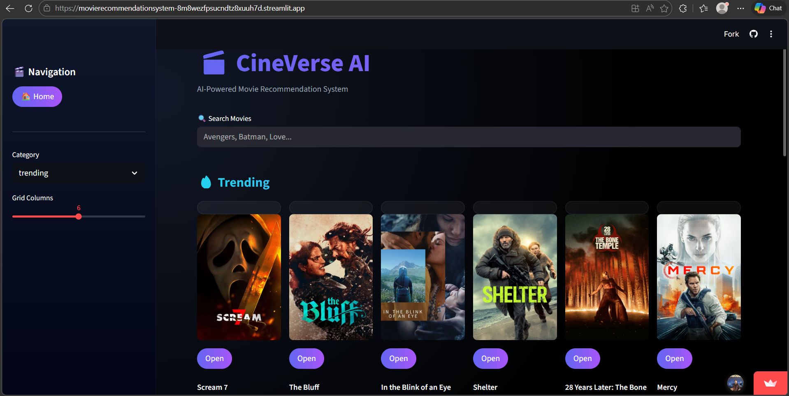
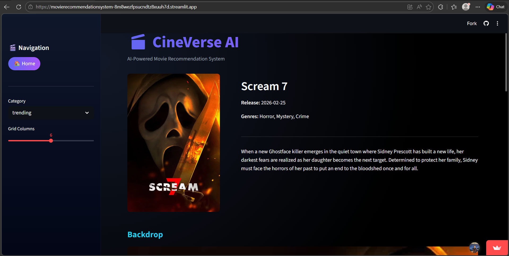
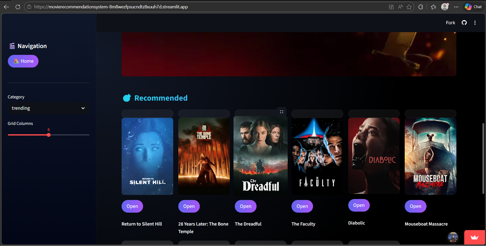

# Movie Recommendation System

A movie discovery application that combines a FastAPI backend, a Streamlit interface, content-based recommendations, and movie information from [The Movie Database (TMDB)](https://www.themoviedb.org/).

## Features

- Search for movies and browse trending, popular, top-rated, now-playing, and upcoming titles.
- View movie details, including overview, genres, release date, and artwork.
- Get content-based recommendations from a locally stored TF-IDF model.
- Discover popular movies from the same genre through TMDB.
- Explore the FastAPI endpoints using the automatically generated Swagger UI.

## Screenshots

<p align="center">
  
  <br /><br />
  
  <br /><br />
  
</p>

## How it works

The application has two main components:

1. **FastAPI backend** — exposes the movie and recommendation endpoints.
2. **Streamlit frontend** — provides the movie browsing and search interface.

The local recommendation service compares a movie's precomputed TF-IDF vector with the other movie vectors using cosine similarity. Its matrix is stored as a SciPy sparse matrix to use less memory than an equivalent dense matrix.

TMDB supplies movie search results, details, posters, and genre-based discovery. The TF-IDF recommendations use local data files; genre recommendations are requested from TMDB.

## Project structure

```text
.
├── app/
│   ├── routers/             # FastAPI route handlers
│   ├── services/            # TF-IDF recommender and TMDB client
│   ├── utils/               # Shared helpers
│   ├── config.py            # Environment and data-file configuration
│   ├── main.py              # FastAPI application
│   └── models.py            # API response models
├── docs/                    # Project documentation
├── notebooks/               # Data exploration and model preparation
├── scripts/                 # Benchmark scripts
├── screenshots/             # Application screenshots
├── tests/                   # Pytest suite
├── streamlit_app.py         # Streamlit frontend
├── requirements.txt
└── render.yaml              # Render configuration for the API
```

The recommendation data is not included in the repository. The backend expects these files in a `data/` directory:

```text
data/
├── df.pkl
├── indices.pkl
├── tfidf_matrix.pkl
└── tfidf.pkl
```

Make sure these files are available before starting the API. See the notebook in `notebooks/` for the data and model preparation workflow.

## Requirements

- Python 3.11 or later
- A TMDB API key
- The four recommendation data files listed above

## Local setup

### 1. Get the project

Clone the repository using its Git URL, or open the project folder directly:

```bash
git clone https://github.com/naveenkumarr1812/Movie_Recommendation_System.git
cd Movie_Recommendation_System
```

### 2. Create and activate a virtual environment

```bash
python -m venv .venv
```

Windows PowerShell:

```powershell
.\.venv\Scripts\Activate.ps1
```

macOS/Linux:

```bash
source .venv/bin/activate
```

### 3. Install dependencies and configure TMDB

```bash
pip install -r requirements.txt
```

Copy `.env.example` to `.env`, then replace the placeholder with your TMDB API key:

```env
TMDB_API_KEY=your_tmdb_api_key_here
```

### 4. Add the recommendation data

Place `df.pkl`, `indices.pkl`, `tfidf_matrix.pkl`, and `tfidf.pkl` in the `data/` directory at the project root.

### 5. Start the API

```bash
uvicorn app.main:app --reload --port 8000
```

The API is available at `http://127.0.0.1:8000`. Interactive API documentation is at `http://127.0.0.1:8000/docs`.

### 6. Start the Streamlit app

In a second terminal:

```bash
streamlit run streamlit_app.py
```

The frontend's API address is configured in `streamlit_app.py`. To connect it to the local backend, set `API_BASE` to `http://127.0.0.1:8000`.

## API endpoints

| Method | Endpoint | Description |
| --- | --- | --- |
| `GET` | `/health` | Check API health |
| `GET` | `/home` | Browse a movie category |
| `GET` | `/tmdb/search` | Search TMDB for movies |
| `GET` | `/movie/id/{tmdb_id}` | Get movie details by TMDB ID |
| `GET` | `/movie/search` | Find a movie and return recommendation results |
| `GET` | `/recommend/tfidf` | Get local TF-IDF recommendations |
| `GET` | `/recommend/genre` | Get TMDB genre recommendations |

## Tests and benchmarks

Run the test suite:

```bash
pytest
```

To run the memory benchmark, make sure the TF-IDF matrix file is present:

```bash
python scripts/benchmark_memory.py
```

To measure API response times, start the backend first, then run:

```bash
python scripts/benchmark_latency.py
```

Benchmark results depend on the dataset, machine, and network conditions.

## Deployment

`render.yaml` configures a Render web service for the FastAPI backend. Configure `TMDB_API_KEY` in the service environment and ensure the required recommendation data files are available to the running service. The Streamlit frontend is a separate application and must be deployed or run separately with its API address pointing to the deployed backend.

